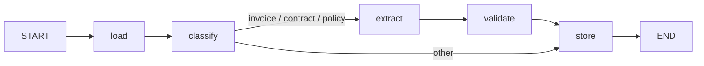
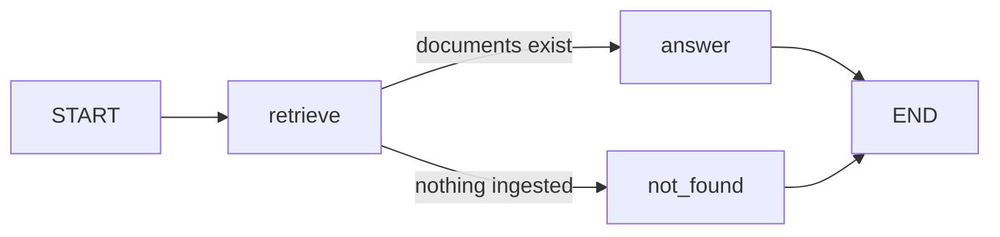

# 02 · Document Intelligence

Ingest business documents (`.txt`, `.md`, `.pdf`), classify them, extract structured fields, **check the numbers**, store everything in Supabase and answer questions with citations.

The sample invoice contains a deliberate error: its line items add up to 46,500 but the subtotal says 47,500. The validation step catches it.

## Database setup (Supabase)

1. Open your project in the [Supabase Dashboard](https://supabase.com/dashboard) → **SQL Editor** → **New query**.
2. Paste the SQL from each step below, in order, and click **Run**. "Success. No rows returned" means it worked.
3. Run the verify query at the end.

All statements are idempotent (`if not exists`, `on conflict do nothing`), so running them twice never duplicates data. The same SQL is part of [`supabase/schema.sql`](../supabase/schema.sql), which sets up **all six modules at once**; if you have already run that, skip this section.

This module doesn't use the shared tables.

**Step 1: document tables**: `documents`, `document_chunks` (full-text indexed) and the `search_document_chunks()` function.

```sql
create table if not exists documents (
    id bigint generated by default as identity primary key,
    filename text not null unique,
    doc_type text,
    summary text,
    extracted jsonb,
    issues jsonb,
    char_count int,
    created_at timestamptz not null default now()
);

create table if not exists document_chunks (
    id bigint generated by default as identity primary key,
    document_id bigint not null references documents (id) on delete cascade,
    chunk_index int not null,
    content text not null,
    fts tsvector generated always as (to_tsvector('english', content)) stored
);
create index if not exists document_chunks_fts_idx on document_chunks using gin (fts);

create or replace function search_document_chunks(q text, k int default 4)
returns table (document_id bigint, filename text, doc_type text, chunk_index int, content text, rank real)
language sql stable as $$
    select c.document_id, d.filename, d.doc_type, c.chunk_index, c.content, ts_rank(c.fts, query) as rank
    from document_chunks c
    join documents d on d.id = c.document_id,
         websearch_to_tsquery('english', regexp_replace(trim(q), '\s+', ' or ', 'g')) query
    where c.fts @@ query
    order by rank desc
    limit k;
$$;

alter table documents       enable row level security;
alter table document_chunks enable row level security;
```

**Step 2: insert data.** These tables are filled by ingesting documents, not by SQL:

```bash
python main.py ingest sample_docs
```

**Verify:** run this query; you should see `documents` 3, `document_chunks` 3 or more.

```sql
select 'documents' as table_name, count(*) as row_count from documents
union all select 'document_chunks' as table_name, count(*) as row_count from document_chunks;
```

<!-- supabase-snapshot:start -->

### See it in Supabase

After running the SQL above:

1. **Create:** left sidebar → **SQL Editor** (`>_` icon) → **New query** → paste the SQL → **Run** (or Ctrl+Enter).
2. **Check:** left sidebar → **Database** → **Tables**, schema **public**. You should see this module's tables: `documents`, `document_chunks`.
3. **Browse data:** click a table (or open **Table Editor**, the grid icon) to see its rows; **View columns** lists the column types.

> The dashboard shows rows because you are logged in as the project owner. Row Level Security still blocks the public (anon) key.


<sub>Tables `chat_messages` … `fin_accounts`</sub>

### Table snapshot

Generated from the live database with `python supabase/snapshot_readmes.py`.

#### `documents` · 3 rows

| Column | Type | Notes |
|--------|------|-------|
| `id` | bigint | PK, auto id |
| `filename` | text | unique, required |
| `doc_type` | text |  |
| `summary` | text |  |
| `extracted` | jsonb |  |
| `issues` | jsonb |  |
| `char_count` | integer |  |
| `created_at` | timestamp with time zone | default `now()`, required |

Sample rows:

| id | filename | doc_type | char_count |
|---|---|---|---|
| 3 | cloudhost_service_agreement.md | contract | 1331 |
| 4 | invoice_techsupply.txt | invoice | 738 |
| 5 | shopease_return_policy.md | policy | 1015 |

#### `document_chunks` · 6 rows

| Column | Type | Notes |
|--------|------|-------|
| `id` | bigint | PK, auto id |
| `document_id` | bigint | FK → `documents`, required |
| `chunk_index` | integer | required |
| `content` | text | required |
| `fts` | tsvector | generated (full-text search) |

_Rows are created by the app (sample rows not shown)._

<!-- supabase-snapshot:end -->

## Graphs

**Ingestion** (`ingest_graph.py`)



| Node | What it does |
|------|--------------|
| `load` | Reads the file (PDF via `pypdf`) |
| `classify` | LLM structured output: `doc_type` + summary |
| `extract` | LLM structured output with a per-type Pydantic schema (`InvoiceFields`, `ContractFields`, `PolicyFields`) |
| `validate` | Pure Python checks: line math, subtotal + tax = total, date order, missing parties, auto-renewal without notice period |
| `store` | Upserts into `documents`, re-chunks into `document_chunks` (full-text indexed) |

**Question answering** (`qa_graph.py`)



`retrieve` combines full-text passage search with a catalog of every document's extracted fields and validation issues, so the model can answer both "what does it say?" and "is anything wrong?" questions.

## Run

```bash
cd 02_document_intelligence
python main.py ingest sample_docs
python main.py list
python main.py show invoice_techsupply.txt
python main.py ask "When does the CloudHost agreement end and how much notice is needed to stop renewal?"
python main.py chat
```

## Try these questions

```
What is the total due on the TechSupply invoice and when is it due?
Are there any problems with the invoices?
What is the monthly fee in the hosting contract and what are the service credits?
Can I return opened earbuds?
How much is deducted for a change-of-mind return?
```

## API

```bash
uvicorn api:app --port 8002      # docs: http://127.0.0.1:8002/docs
```

| Method | Path | Body / params | Returns |
|--------|------|---------------|---------|
| POST | `/documents` | multipart `file` (.txt / .md / .pdf, max 5 MB) | Type, summary, extracted fields, issues, chunk count |
| POST | `/documents/samples` | | Ingests everything in `sample_docs/` |
| GET | `/documents` | | All documents |
| GET | `/documents/{id}` | | One document with extracted fields |
| DELETE | `/documents/{id}` | | Removes the document and its chunks |
| POST | `/ask` | `{"question": "..."}` | `answer`, `sources` |
| GET | `/health` | | `{"status": "ok"}` |

```bash
curl -F "file=@sample_docs/invoice_techsupply.txt" http://127.0.0.1:8002/documents
```

## What to learn from it

- Branching a pipeline on an LLM classification.
- Using **Pydantic schemas** for reliable extraction.
- Keeping arithmetic and business rules in code; LLMs are bad calculators.
- Grounded answers with `[filename #chunk]` citations.
