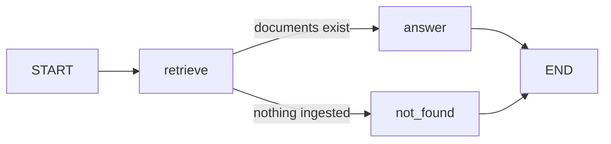

# 02 · Document Intelligence

Ingest business documents (`.txt`, `.md`, `.pdf`), classify them, extract structured fields, **check the numbers**, store everything in Supabase and answer questions with citations.

The sample invoice contains a deliberate error: its line items add up to 46,500 but the subtotal says 47,500. The validation step catches it.

## Graphs

**Ingestion** (`ingest_graph.py`)


| Node | What it does |
|------|--------------|
| `load` | Reads the file (PDF via `pypdf`) |
| `classify` | LLM structured output: `doc_type` + summary |
| `extract` | LLM structured output with a per-type Pydantic schema (`InvoiceFields`, `ContractFields`, `PolicyFields`) |
| `validate` | Pure Python checks: line math, subtotal + tax = total, date order, missing parties, auto-renewal without notice period |
| `store` | Upserts into `documents`, re-chunks into `document_chunks` (full-text indexed) |

**Question answering** (`qa_graph.py`)



`retrieve` combines full-text passage search with a catalog of every document's extracted fields and validation issues, so the model can answer both "what does it say?" and "is anything wrong?" questions.

## Run

```bash
cd 02_document_intelligence
python main.py ingest sample_docs
python main.py list
python main.py show invoice_techsupply.txt
python main.py ask "When does the CloudHost agreement end and how much notice is needed to stop renewal?"
python main.py chat
```

## Try these questions

```
What is the total due on the TechSupply invoice and when is it due?
Are there any problems with the invoices?
What is the monthly fee in the hosting contract and what are the service credits?
Can I return opened earbuds?
How much is deducted for a change-of-mind return?
```

## API

```bash
uvicorn api:app --port 8002      # docs: http://127.0.0.1:8002/docs
```

| Method | Path | Body / params | Returns |
|--------|------|---------------|---------|
| POST | `/documents` | multipart `file` (.txt / .md / .pdf, max 5 MB) | Type, summary, extracted fields, issues, chunk count |
| POST | `/documents/samples` | | Ingests everything in `sample_docs/` |
| GET | `/documents` | | All documents |
| GET | `/documents/{id}` | | One document with extracted fields |
| DELETE | `/documents/{id}` | | Removes the document and its chunks |
| POST | `/ask` | `{"question": "..."}` | `answer`, `sources` |
| GET | `/health` | | `{"status": "ok"}` |

```bash
curl -F "file=@sample_docs/invoice_techsupply.txt" http://127.0.0.1:8002/documents
```

## What to learn from it

- Branching a pipeline on an LLM classification.
- Using **Pydantic schemas** for reliable extraction.
- Keeping arithmetic and business rules in code; LLMs are bad calculators.
- Grounded answers with `[filename #chunk]` citations.
